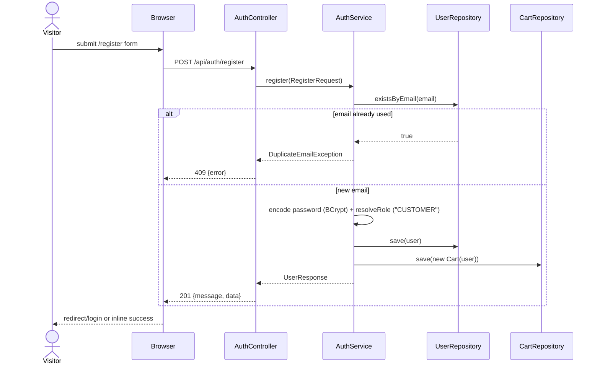
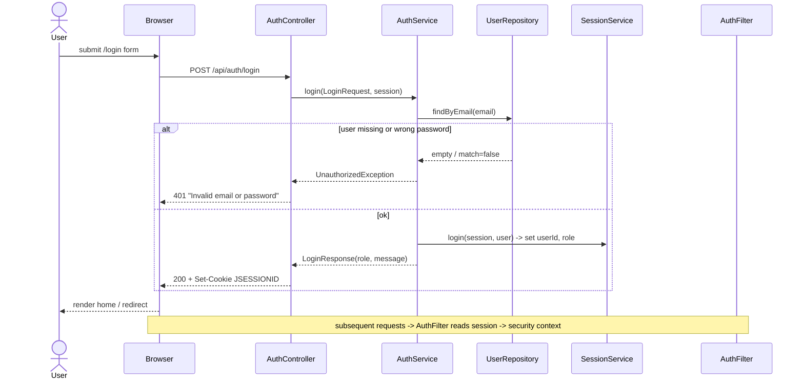
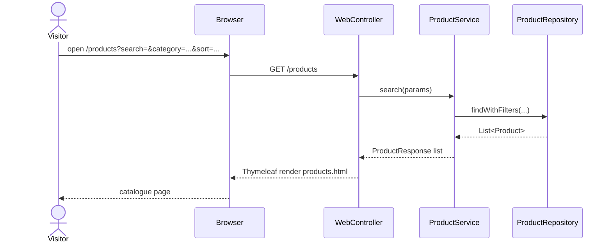
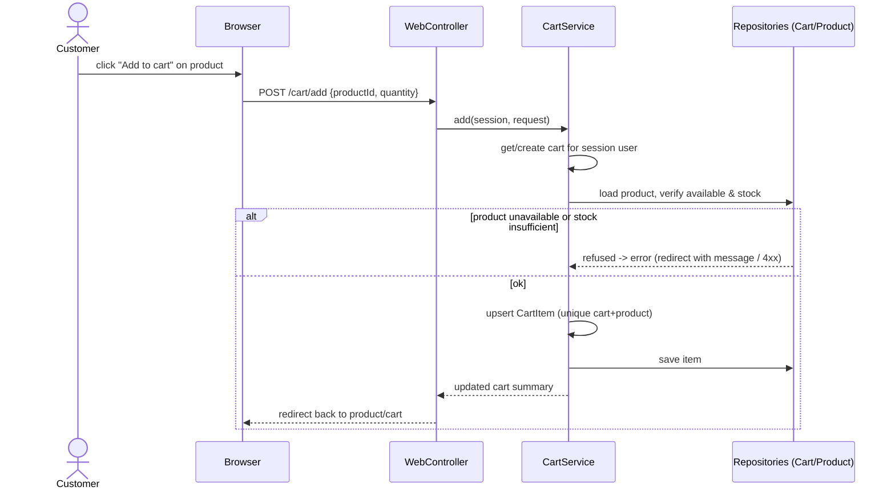
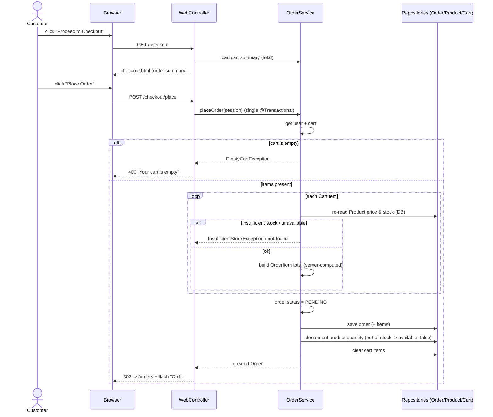
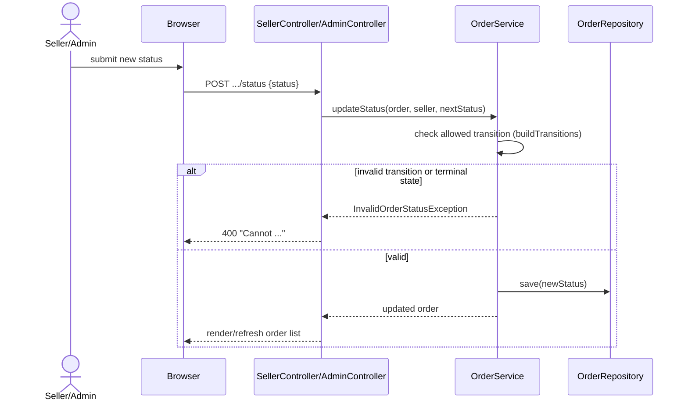
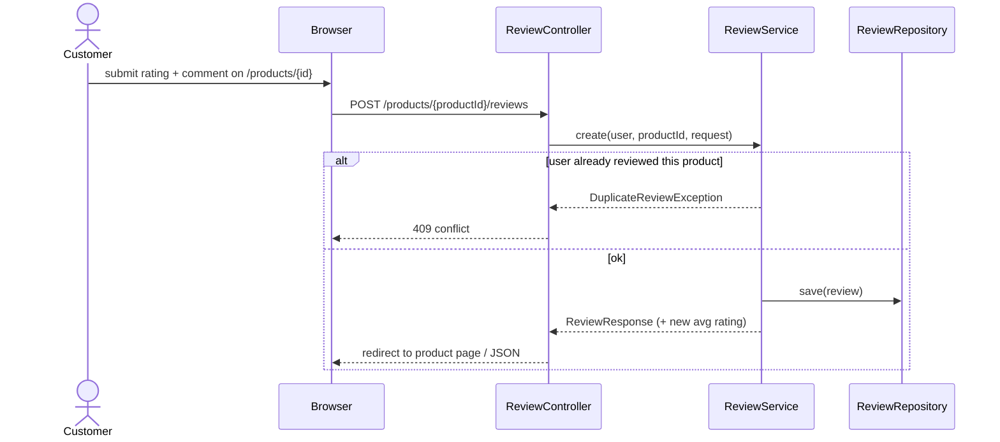
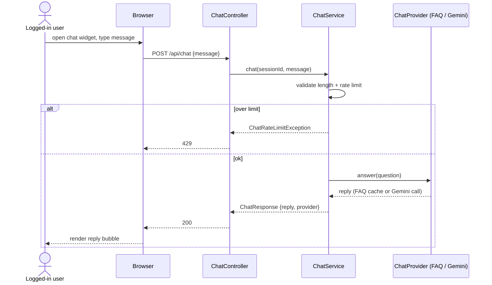
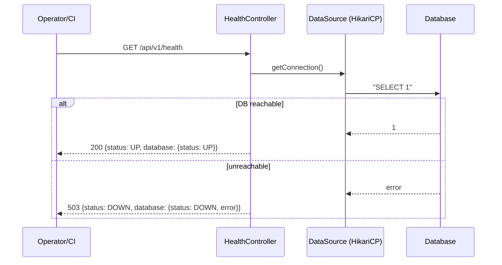

# SEQUENCE_DIAGRAMS.md — RayyanMart Online Shopping System

Sequence diagrams for the real request flows. Mermaid renders on GitHub/GitLab.

---

## 1. Registration (CUSTOMER)

---

## 2. Login (session)

---

## 3. Browse & filter products

---

## 4. Add product to cart

---

## 5. Checkout & place order

> No payment step exists anywhere in this flow — see PROJECT_OVERVIEW.md.

---

## 6. Order status update (seller/admin)

---

## 7. Review product

---

## 8. Shopping assistant (chat)

---

## 9. Health probe

