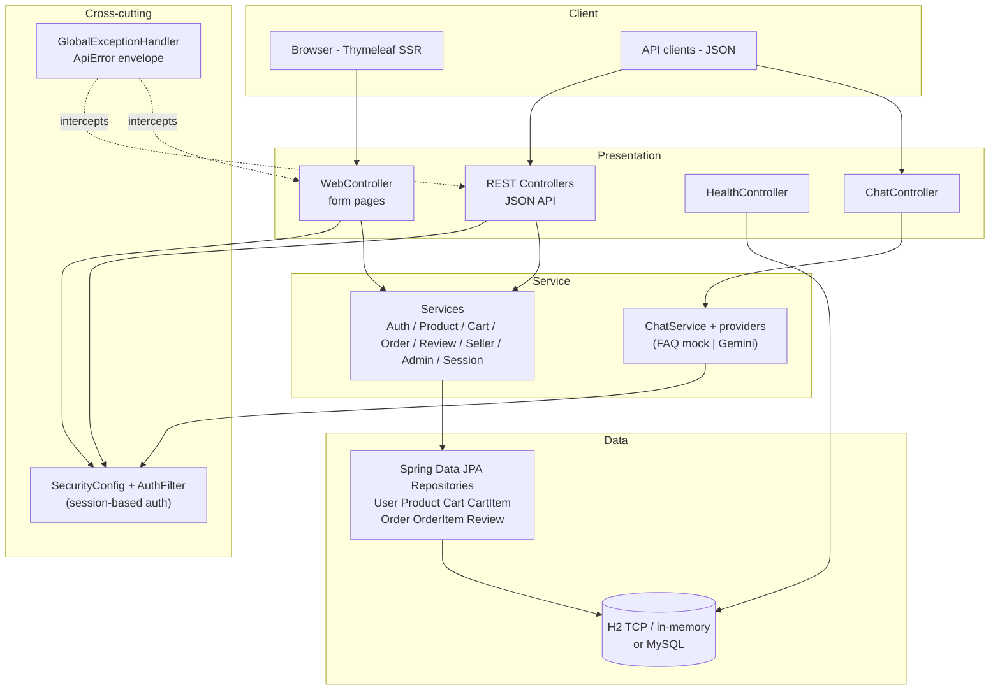

# SYSTEM_ARCHITECTURE.md — RayyanMart Online Shopping System

High-level, code-accurate architecture. Layered Spring Boot application packaged
as a WAR for Tomcat 9.0.x.

## Tech stack (from `pom.xml`)

| Concern | Technology |
|---|---|
| Language / compile target | Java 17 |
| Framework | Spring Boot 2.7.18 (Spring MVC) |
| Packaging | WAR (embedded Tomcat 9 `provided`) |
| Persistence | Spring Data JPA + Hibernate 5 (H2 default; MySQL driver bundled) |
| Security | Spring Security (BCrypt) + custom `AuthFilter` servlet filter |
| Server-side UI | Thymeleaf 3 templates (SSR; no JS frontend) |
| Validation | Bean Validation (`spring-boot-starter-validation`) |
| Build | Apache Maven 3.8+ |
| Tests | JUnit 5 (spring-boot-starter-test), MockMvc, `spring-security-test` |

## Layered view

## Components

### Presentation layer
- **`web/WebController`** — the server-rendered site: `/`, `/login`, `/register`,
  `/products`, `/products/{id}`, `/cart`, `/checkout`, `/orders`, `/seller`,
  `/admin`. Each handler resolves the current user from the session
  (`SessionService`) and renders a Thymeleaf template from
  `src/main/resources/templates/`.
- **`controller/*`** — REST JSON controllers:
  `AuthController`, `ProductController`, `CartController`, `OrderController`,
  `ReviewController`, `SellerController`, `AdminController`, `ChatController`,
  `HealthController`.
- **`web/Ui`** — view helpers (₹ formatting at 83.00/USD, star ratings, badges,
  date formatting) used by templates.

### Service layer
- `AuthService`, `ProductService`, `CartService`, `OrderService`, `ReviewService`,
  `SellerService`, `AdminService`, `SessionService`.
- `service/chat/*` — `ChatService` plus `ChatProvider` implementations:
  `FAQChatProvider` (deterministic, default `mock`) and `GeminiChatProvider`
  (optional, requires `GEMINI_API_KEY`); guarded by `ChatDomainGuard`.
- Key invariants enforced in services: BCrypt password encoding; server-side
  price re-read at order time; stock revalidation at checkout; allowed
  `OrderStatus` transitions; seller scoping of products/orders; one review per
  user per product; per-session chat rate limit.

### Data layer
- JPA entities: `User`, `Product`, `Cart`, `CartItem`, `Order`, `OrderItem`,
  `Review` (7 tables — see DATABASE_SCHEMA.md).
- Spring Data repositories: `UserRepository`, `ProductRepository`,
  `CartRepository`, `CartItemRepository`, `OrderRepository`, `OrderItemRepository`,
  `ReviewRepository`.
- Schema owned by Hibernate (`ddl-auto=update`), seeded by `data.sql`.

### Security
- `SecurityConfig`: CSRF disabled, form-login/basic/HTTP logout disabled, all
  requests permitted at filter level, **session-based** authorization performed in
  each controller/service via `SessionService` (attributes `userId` + `role`).
- `AuthFilter` populates the security context from the session so `@Security`
  checks and web pages see the same identity.
- `AdminInitializer` (a `CommandLineRunner`) creates a single ADMIN account when
  `ADMIN_EMAIL`/`ADMIN_PASSWORD` are configured.

### Error handling
- `GlobalExceptionHandler` (`@RestControllerAdvice`) maps typed exceptions to a
  consistent `ApiError {timestamp, status, error, message}` envelope:
  400 (validation/empty-cart/bad status), 401, 403, 404, 405, 409 (duplicate
  email/review, stock conflict, data integrity), 429 (chat rate limit), 500.

## Request flows (short form)

- **Browser (HTML)**: HTTP → `AuthFilter` → `WebController` handler → `SessionService`
  resolve user → service → repository/DB → Thymeleaf renders HTML → response.
- **API client (JSON)**: HTTP → `AuthFilter` → REST controller → service →
  repository/DB → JSON response (or `ApiError` via advice).
- **Chat bot**: `POST /api/chat` → `ChatService.chat(sessionId, message)` →
  provider (FAQ cache or Gemini) → `{reply, provider}` (rate-limited per session).

Detailed sequence diagrams: SEQUENCE_DIAGRAMS.md. Routes: API_DOCUMENTATION.md.