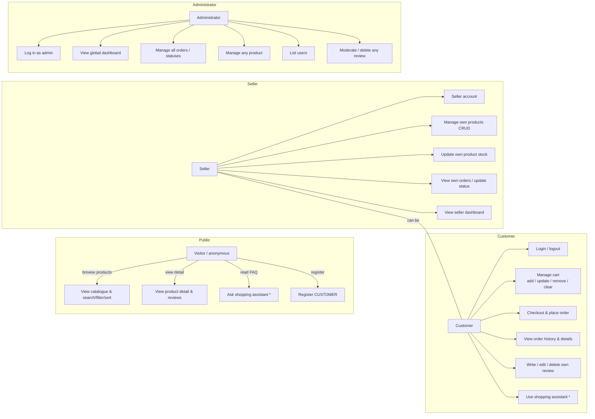

# USE_CASE_DIAGRAM.md — RayyanMart Online Shopping System

Actors and use cases that are actually implemented in the code.

\* The shopping assistant REST endpoint is public; the floating widget in the UI
is rendered only for logged-in users.

## Use-case → implementation map (evidence)

| UC | Where implemented | Notes / status |
|---|---|---|
| Browse & search | `WebController /products`, `ProductController.search`, `ProductService` | VERIFIED (tests) |
| View product detail | `/products/{id}`, `ProductController.get` | VERIFIED |
| Ask shopping assistant | `ChatController` + `ChatService` + FAQ/Gemini providers | VERIFIED (tests, live) |
| Register | `/api/auth/register`, `WebController.register` | role CUSTOMER/SELLER only |
| Login/logout | `/api/auth/login` and `/api/auth/logout`, session cookie | VERIFIED |
| Manage cart | `CartController` + `CartService` | VERIFIED |
| Checkout & place order | `/checkout/place` (web), `POST /api/orders` | VERIFIED |
| Order history | `/orders`, `GET /api/orders`, `/api/orders/{id}` | VERIFIED |
| Reviews | `ReviewController` + `ReviewService` | one per user/product; VERIFIED |
| Seller manage own products/stock | `SellerController` (`/api/seller/products*`) | scoped to `seller_id`; VERIFIED |
| Seller orders/status | `SellerService` + seller order views | VERIFIED |
| Admin dashboard/orders/products/users/reviews | `AdminController` (`/api/admin/*`) | present; **no automated admin tests** |

## Security notes

- `SessionService.getCurrentSeller` / `getCurrentAdmin` throw 403 for the wrong role.
- Registration can **never** yield ADMIN (`AuthService.resolveRole`).
- Customers can only view their **own** orders and edit their **own** reviews
  (admin may delete any review).