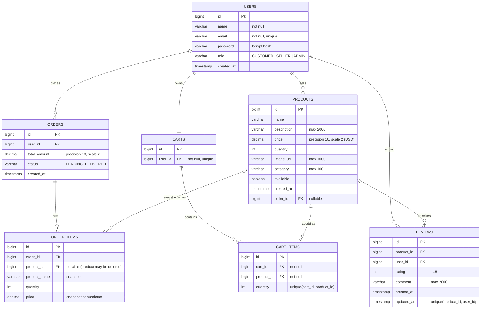

# Database design

## Overview

RayyanMart uses **Hibernate-managed schema** (`spring.jpa.hibernate.ddl-auto=update`).
The same schema supports H2 (dev/test) and MySQL (production) thanks to Hibernate's DDL.
`docs/schema.sql` documents the resulting relational model and can be used to set up a
database manually (e.g. with Hibernate `ddl-auto=none/validate`).

Stored product/order prices are in **USD**; the store front converts to **Indian rupees
(₹)** at the fixed 83.00 rate via the `Ui` view helper and the chat provider. This is a
deliberate display-only conversion.

## ER diagram

## Notes

- **One cart per user** (`user_id` unique); carts and their items are cascade-deleted with
  the user.
- **Order items snapshot** product name and price so historical orders survive product
  deletion or price changes. `product_id` is nullable and only used for lookups.
- **One review per (user, product)** — enforced by unique constraint + service logic.
  Only purchasers may review; owners may edit/delete their own; admins may remove any.
- **Stock validation** happens in `OrderService.placeOrder` inside a transaction using
  pessimistic/optimistic checks against `product.quantity`; placing an order decrements
  product stock.
- Prices use `DECIMAL(10,2)`, never float/double. Money display conversion is done at the
  view layer only.

See full DDL in [schema.sql](schema.sql) and relational rules in
[architecture.md](architecture.md).