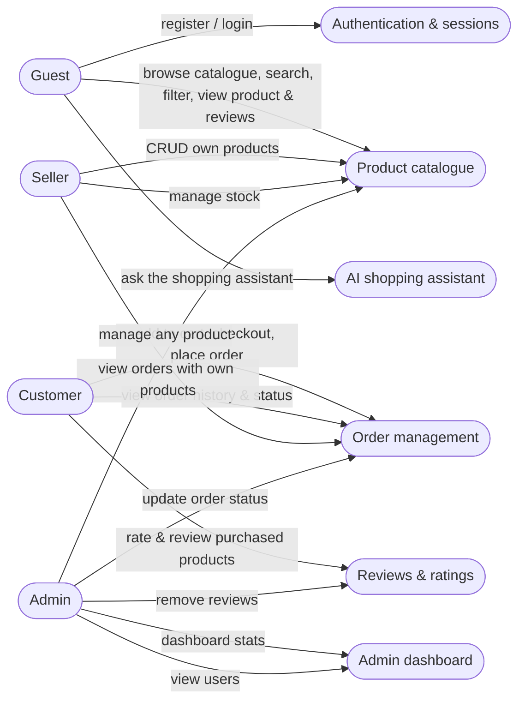
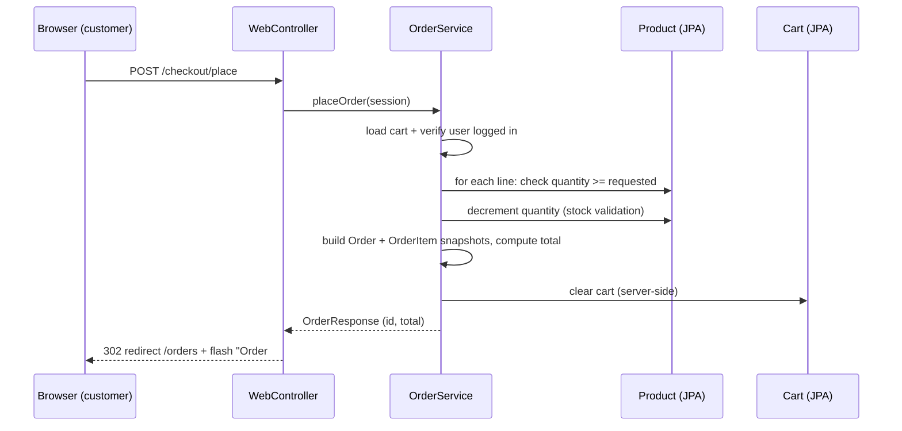
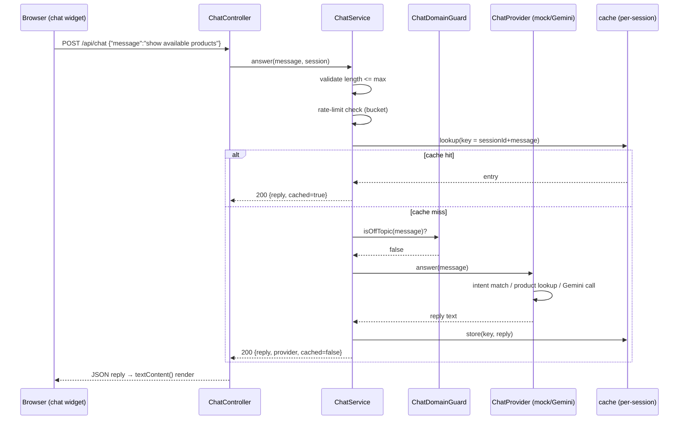
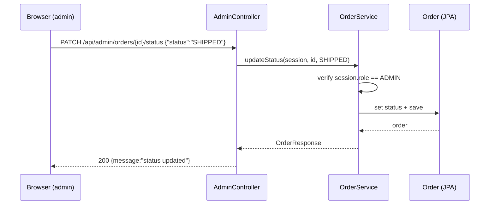
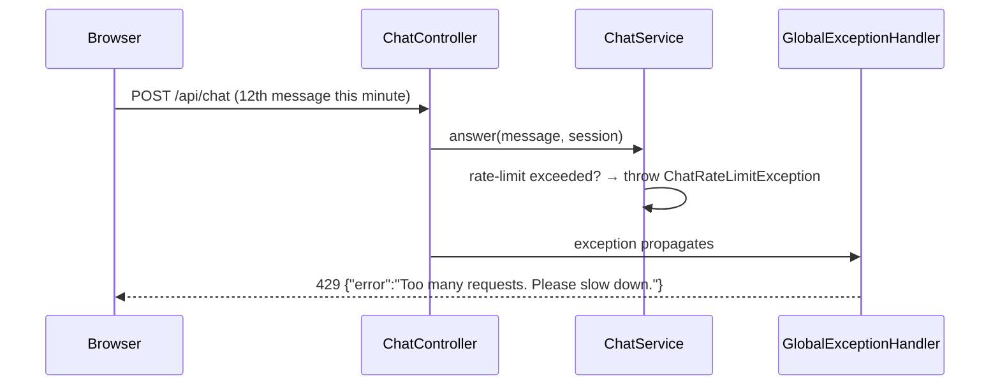

# Diagrams

## Use-case diagram

## Sequence: place an order (happy path)

## Sequence: AI assistant request

## Sequence: admin updates order status

## Sequence: rate limited chat call

(These diagrams are Mermaid — render in any GitHub-flavoured Markdown viewer or
[mermaid.live](https://mermaid.live).)